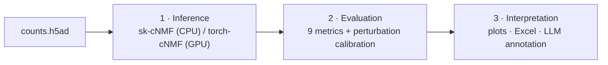

# PerturbNMF

PerturbNMF runs consensus non-negative matrix factorization (cNMF) on Perturb-seq and other
single-cell CRISPR screen data. It infers gene programs, scores them, tests which perturbations
change them and helps you interpret the results. It is built around three stages:

- **Inference.** Run cNMF on the CPU (sk-cNMF) or on a GPU (torch-cNMF), across many values of K
  in a single run.
- **Evaluation.** Nine metrics for choosing K and checking program quality, plus calibrated
  perturbation tests (U-test, conditional randomization test, matched-cell DE).
- **Interpretation.** K-selection and per-program plots, an Excel summary, HTML reports, and
  LLM-assisted program annotation.

It runs on a single machine. SLURM runner scripts are included for clusters.



## Installation

PerturbNMF is a set of scripts and notebooks. Clone the repository and create the conda
environment for the stage you want to run:

```bash
git clone https://github.com/EngreitzLab/PerturbNMF.git
cd PerturbNMF
conda env create -f src/Stage1_Inference/torch-cNMF/environment.yml
```

See {doc}`installation` for the other environments and the Stage 2 reference data.

## Documentation

New to PerturbNMF? {doc}`quickstart` runs Stage 1 on PBMC3k in a few minutes. The
{doc}`tutorials/index` go through each stage step by step, the {doc}`guide/index` lists every
parameter and output, and the {doc}`explorer` shows programs from the paper datasets.

## Citation

If you use PerturbNMF, cite the concept DOI
[10.5281/zenodo.21878267](https://doi.org/10.5281/zenodo.21878267). See {doc}`citation`.

```{toctree}
:hidden:

quickstart
installation
tutorials/index
guide/index
explorer
changelog
citation
```
